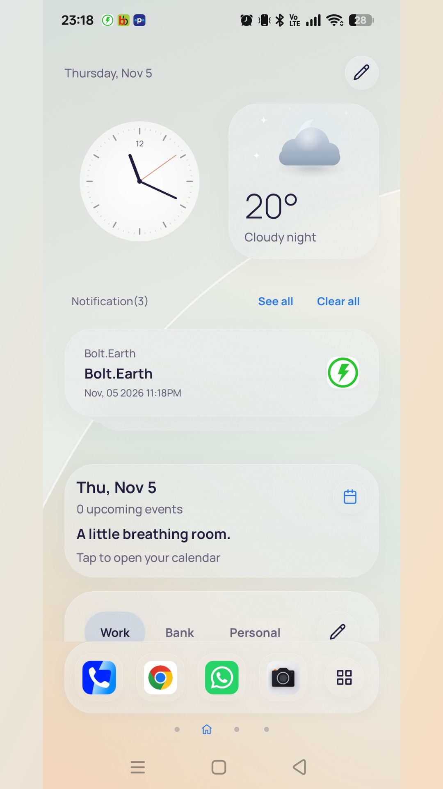
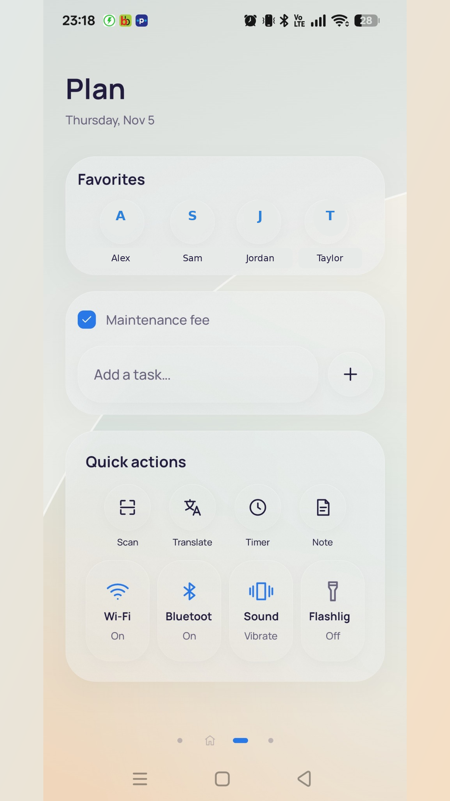
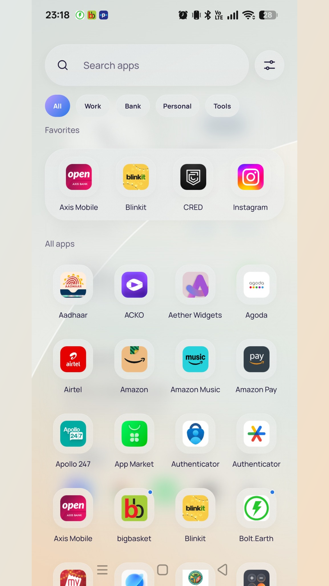

# Fluid Launcher

A native Android home launcher built with Kotlin and Jetpack Compose, with frosted-glass styling, customizable pages and animated widgets.

## Screenshots

| Home | Plan | App drawer |
| --- | --- | --- |
|  |  |  |

## Changelog

### 1.0.0 — Initial release

- Customizable Home, Plan, Your space and custom pages with a four-column widget grid, widget resizing and drag-to-rearrange controls.
- Searchable app drawer, favorites, editable app collections and a customizable dock.
- Animated widgets for weather, music, focus, breathing, world clocks, battery, water and activity, alongside notifications, calendar events and tasks.
- Built-in Clock with alarms, world clocks, stopwatch and timer. Includes switched-off starter alarms and optional import of the next system alarm.
- Wallpaper, accent and light/dark appearance controls, with locally persisted preferences.

Version: **1.0.0**. Build number: **1**. Application ID: `com.cry.fluid`. Requires Android 8.0 or later.

## Privacy

Read the [Fluid Launcher Privacy Policy](https://cryadhu.github.io/fluid-launcher/) for information about permissions, on-device storage, third-party services and deleting local data.

## Setup and permissions

Choose Fluid Launcher as your default Home app in Android settings. Calendar, notifications, media controls, activity tracking and alarms use Android permissions or special access where required. App collections are launcher groups, not Android managed profiles. System settings and restricted device controls remain managed by Android.

## Build

Requirements: JDK 17 or later, Android SDK platform 36 and the Gradle wrapper.

```powershell
.\gradlew.bat :app:testDebugUnitTest :app:lintRelease :app:bundleRelease :app:assembleRelease
```

Release builds require local signing configuration in the ignored `signing/release.properties` file and its existing keystore. Keep keystores, passwords, local configuration and generated AAB/APK files out of Git. Reuse the same signing identity for future updates.
